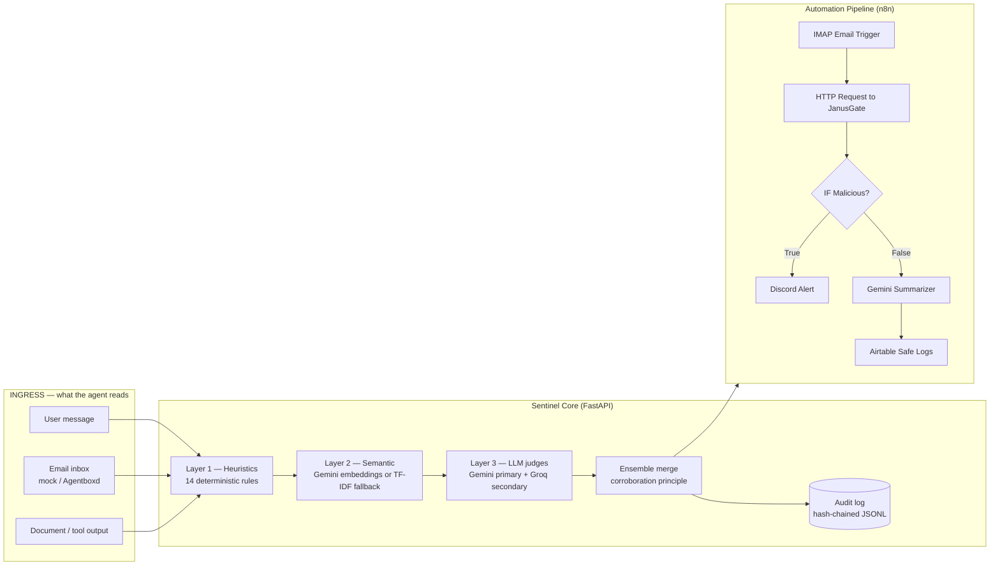

# JanusGate 🏛️🛡️

> *One face watches what enters. One watches what leaves.*
[](https://m8ven.ai/mcp/hamsavartn-janusgate-1wpc09?s=readme)

**A two-way security firewall + audit trail for AI agents — inspects both ingress (what the agent reads) and egress (what it sends), with a per-message scam report for human recipients.**

AI agents now read emails, browse documents, and call tools autonomously. The OWASP LLM Top 10 documents the attack surface: prompt injection (LLM01), sensitive information disclosure (LLM02), excessive agency (LLM06), and system-prompt leakage (LLM07). JanusGate inspects **everything an agent reads and everything it sends**, returns **sub-second evidence-backed verdicts** (heuristics + semantic in <1 ms; full ensemble with LLM judge ~1 s), produces a per-message **scam report**, and records every decision in a **SHA-256 hash-chained audit log**.

> ForgeHacks 2026 submission · Track: **AI + Cybersecurity**

## 🚀 Live Demos
> 💡 **Tip for Judges:** We recommend opening both of these links at the same time in separate tabs! The Render API is on a free tier and may take ~30 seconds to spin up from sleep. 

* **Dashboard (Streamlit):** [https://jansgate.streamlit.app/](https://jansgate.streamlit.app/)
* **Core API (Render):** [https://janusgate-api.onrender.com/docs](https://janusgate-api.onrender.com/docs)
* **Youtube (Tutorial link): ** [https://youtu.be/Li-NzvcNEj4?si=qn7lLXd-Zpervq2i]

## Why this matters

Open-source defenses exist — Llama Prompt Guard, LLM Guard, NeMo Guardrails, Rebuff — and commercial APIs are available from several vendors. JanusGate's contribution is a **layered, self-measuring** defense that combines heuristics, semantic similarity, and multi-model LLM judges with **egress defense** (canary tripwires, credential leak detection) and a **hash-chained audit trail**. It runs anywhere, including fully offline with reduced coverage.

## Architecture & Integration Pipeline

JanusGate exposes a FastAPI backend designed as middleware for automation pipelines (n8n, Make, Zapier).



### Detection ensemble

Degrades gracefully — runs with zero API keys (heuristics + TF-IDF semantic only), but **coverage drops significantly without the LLM judge**. The verdict includes a `layers_used` field so downstream consumers can route degraded-mode results differently.

| Layer | What | Latency |
|---|---|---|
| **1. Heuristics** | 14 pattern rules: direct/indirect injection, jailbreaks, tool hijacking, exfiltration, phishing, non-English injection phrases | <1 ms |
| **2. Semantic** | Cosine similarity vs labeled attack corpus — Gemini embeddings online, **offline TF-IDF fallback** (word + char n-gram channels). Uncorroborated TF-IDF hits need ≥0.70 similarity; Gemini mode ≥0.90. Base threshold 0.35. | <1 ms offline |
| **3. LLM judges** | **Gemini** (primary, structured output) + **Groq-hosted open model** (secondary, when `GROQ_API_KEY` set). Disagreement surfaced via `judges_disagree` flag; higher-risk verdict wins. | ~1 s |
| **Egress** | Canary tripwire, credential shapes (AWS/GitHub/Slack/Google/OpenAI keys, JWTs), verbatim system-prompt echo | <1 ms |

**Merge policy:** The ensemble merge takes the max-risk signal (fail-closed *within the merge*). This is NOT the same as a fail-closed deployment — without API keys, Layer 3 is absent and recall drops to ~0.12 on the external benchmark.

**Per-source thresholds:** Email (threshold 4) is held to a stricter standard than user messages (threshold 5), because the attacker controls email content.

## Measured Results

| Suite | n | Precision | Recall | F1 | What it proves |
|---|---|---|---|---|---|
| Dev suite | 41 | 1.00 | 1.00 | 1.00 | ⚠️ Co-designed with the rules — regression guard, **not** generalization evidence. |
| Dev-adjacent | 26 | 1.00 | 1.00 | 1.00 | Author-built after rules were frozen, but **the tuning loop saw its misses** — overstates real-world performance. Treat as a second dev set. |
| **External** | **546** | **1.00** | **0.12** | 0.22 | **[deepset/prompt-injections](https://huggingface.co/datasets/deepset/prompt-injections)** — 343 benign, ~203 attacks. Zero false positives on benign texts. |

**Honest interpretation:** Zero FP on 343 benign samples is encouraging for a firewall, but recall of 0.12 means the detector catches only ~24 of ~203 external attacks. The corroboration gate (which suppresses uncorroborated single-signal detections to maintain precision) likely explains the low recall — this is a hypothesis that a per-layer ablation and gate-threshold sweep would confirm. With 0 FP on n=343, the Wilson 95% upper bound on false-positive rate is ~1.1%, which at scale could yield worst-case precision around 0.86, not the 1.00 shown.

**What's NOT benchmarked:** The scam/impersonation report engine (`scam.py`) is rule-based and has no external benchmark. The phishing heuristics are tested in the dev suite only. External phishing and indirect-injection benchmarks (BIPIA, AgentDojo) are listed as next steps.

## Known Limitations

1. **The n8n "safe" branch is the injection target.** Emails that pass JanusGate go to a Gemini summarizer, which is itself an LLM vulnerable to injection. With recall ~0.12 on external attacks, ~88% of attack payloads reach the summarizer. JanusGate mitigates this by providing a schema-locked tool-less `/summarize` endpoint, dedicated `/email/quarantine` mail isolation, and tool-wrapping via `JanusGuard`.
2. **Distributed rate-limiting & auth.** Bearer API key authentication (`Authorization: Bearer <key>`) and in-memory rate limiting are now active across the API. For multi-worker production deployments, a Redis-backed rate limiter and HMAC-signed audit log anchoring would slot into the existing architecture.
3. **Audit log integrity.** The log is SHA-256 hash-chained (each entry carries `seq`, `prev_hash`, `hash`; verified via `GET /audit/verify`). This detects partial edits but does NOT resist full-chain recomputation by someone with write access. An HMAC with a server-side key or periodic external anchoring would be needed for true tamper-evidence.
4. **Judge model name.** The default `GEMINI_JUDGE_MODEL` is configurable via environment variable. No startup validation currently checks that the model ID exists — a stale default would silently disable the judge (layers 1–2 carry on).
5. **Filename inconsistency.** `judge_featherless.py` was originally written for the Featherless sponsor integration but the actual provider is **Groq** (the code hits `api.groq.com`). The filename is a legacy artifact.

## Run it

### 1. Start the JanusGate Security Engine
JanusGate runs in Docker or via Python environments.
```bash
git clone https://github.com/hamsavartn/JanusGate.git
cd agent-sentinel

# Create .env and add your API keys
cp .env.example .env

# Run the API and Dashboard
docker-compose up -d --build
```
*API is now running on `http://localhost:8123` and the Dashboard is live at `http://localhost:8501`.*

### 2. The n8n Workflow (End-to-End Automation)
JanusGate acts as the brain of an intelligent email triaging system. Using n8n, we build a seamless, secure pipeline:
1. **Email Trigger (IMAP/Schedule/Webhook):** Listens for incoming emails.
2. **JanusGate Inspection (HTTP Request):** Sends email content to `POST /inspect` with Bearer auth.
3. **If Node (Verdict Routing):** Checks `{{ $json.is_attack }}`.
4. **🔴 True (Malicious):** Routes to the **Quarantine Email** node (`POST /email/quarantine`), logs the incident to the audit trail, and alerts on Discord/Slack.
5. **🟢 False (Safe):** Passes to the schema-locked **Summarize with JanusGuard** node (`POST /summarize`), protecting downstream agents.

## Repository Map

```text
agent-sentinel/
├── backend/                           FastAPI core: ingress ensemble, egress defense,
│                                      scam & impersonation reports, audit, tool guard.
│   ├── sentinel_core.py               Ensemble merge logic (corroboration + max-risk)
│   ├── guard.py                       JanusGuard: wrap agent tools with inspection
│   ├── policy.py                      Per-source thresholds + session risk accumulation
│   ├── audit.py                       Hash-chained JSONL audit log + privacy redaction
│   └── engine/                        Heuristics, semantic, LLM judges, egress, scam
├── dashboard/app.py                   Streamlit UI (7 tabs incl. egress + analytics)
├── simulator/                         Dev attack suite + scripted demo scenario
├── evals/                             Eval sets, external validation, verification suite
├── tests/                             pytest suite (37 tests)
├── Dockerfile, docker-compose.yml     Containerized deployment (API + dashboard)
└── .github/workflows/ci.yml           CI: tests + evals on every push
```

## Roadmap (Post-Hackathon)

1. **Eval integrity:** Frozen test split, per-layer ablation, gate-threshold sweep, confidence intervals.
2. **Classifier layer:** Trained DeBERTa or Prompt Guard model as Layer 2b — benchmark against the current ensemble.
3. **Architecture:** Tool-less summarizer with schema-locked output; quarantine flagged mail; wire `guard.py` into the n8n flow.
4. **Hardening:** API key auth, payload size cap, rate limiter, `AUDIT_REDACT=1` by default, HMAC-signed audit chain, startup model validation.
5. **Extended benchmarks:** BIPIA (indirect injection), AgentDojo (agent benchmarks), phishing corpus, obfuscation tests (base64, homoglyphs, zero-width, multilingual).

## Team & Acknowledgments

Built for [ForgeHacks 2026](https://forgehacks.dev) — a student-run hackathon on AI for Real World Problems. Sponsor integrations: **Agentboxd** (agent email inboxes), **Featherless** (hackathon sponsor; secondary judge uses **Groq**-hosted open model via `judge_featherless.py`). Primary judge: Gemini (Google AI Studio).

## License

MIT
